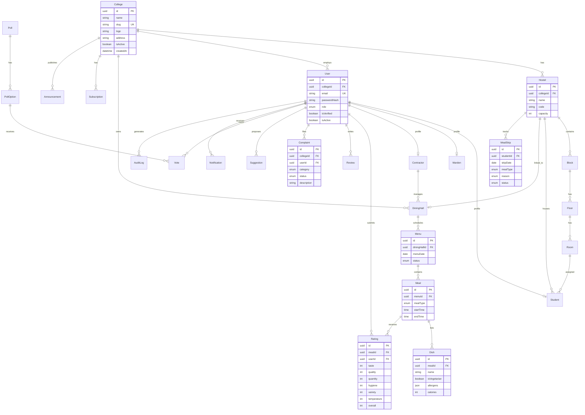

# CDIP Entity-Relationship Diagram

## Tenant Isolation

Every tenant-scoped entity includes `collegeId` (directly or via parent relation). Middleware enforces:

1. JWT contains `collegeId` and `role`
2. Super Admin bypasses tenant filter
3. All queries filter by `collegeId` for non-super-admin users

## Indexes

- `User(email)` — unique login lookup
- `College(slug)` — tenant routing
- `Menu(diningHallId, menuDate)` — daily menu fetch
- `Rating(mealId, userId)` — prevent duplicate ratings
- `Complaint(collegeId, status)` — dashboard queries
- `MealSkip(studentId, skipDate, mealType)` — skip validation
